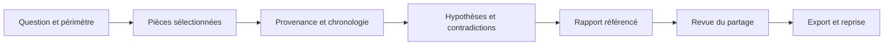

<p align="center">
 
</p>

<h1 align="center">OSINT Forge Skills</h1>

<p align="center">
 <strong>Des enquêtes OSINT et forensic avec des preuves référencées.</strong><br>
 12 skills pour les assistants IA en ligne de commande.<br>
 Claude Code · Codex · OpenCode · Gemini CLI
</p>

<p align="center">
 
 
 
 
</p>

<p align="center">
 <a href="README.md">English</a> ·
 <a href="#démarrer-en-cinq-minutes">Démarrage</a> ·
 <a href="#installer-dans-son-assistant-ia">Installation</a> ·
 <a href="#les-12-skills">Catalogue</a> ·
 <a href="docs/README.md">Documentation</a> ·
 <a href="docs/compatibility.json">Compatibilité</a>
</p>

---

Cette présentation française est conservée pour les lecteurs francophones.
L’[édition principale](README.md) et les guides utilisateur sont désormais en anglais.
Les observations de compatibilité ci-dessous sont celles du 13 octobre 2026.

## Ce que fait ce projet

**OSINT Forge Skills donne aux assistants IA une méthode d'enquête, des outils
locaux et un format de dossier commun.** Le projet aide à examiner des sources
publiques autorisées et des artefacts fournis, à tester les explications
possibles, puis à produire un rapport qui renvoie aux pièces utilisées.

Une skill est un dossier d'instructions spécialisé que le client peut charger
lorsqu'une demande correspond à son rôle. Un plugin regroupe plusieurs skills
pour les installer ensemble. Ici, chaque skill exportée inclut aussi les petits
scripts et les références nécessaires à son fonctionnement.

Le projet s'adresse aux analystes, enquêteurs, journalistes et chercheurs qui
veulent comprendre **ce qui est observé, ce qui est déduit et ce qui reste
inconnu**. Les formateurs peuvent utiliser les cas synthétiques pour travailler
ces distinctions sans manipuler de données réelles.

| L'assistant aide à… | Les outils locaux permettent de… |
| --- | --- |
| Cadrer la question et les limites d'une enquête | Créer un dossier et copier les fichiers explicitement sélectionnés |
| Examiner l'origine et l'indépendance des sources | Regrouper les octets identiques et les origines annotées |
| Tester des hypothèses et leurs contradictions | Enregistrer des conclusions avec des références stables |
| Interpréter des exports de journaux ou d'historique | Normaliser les heures explicites et conserver les incertitudes |
| Rédiger et préparer une transmission | Vérifier, exporter et restaurer le dossier |

Les scripts fonctionnent **hors ligne**, avec la bibliothèque standard de
Python. La recherche web éventuelle passe par les capacités déjà disponibles
dans le client et par le périmètre autorisé par l'utilisateur.

## La signature : preuves et contre-enquête

### Trois articles peuvent reposer sur une seule source

Trois publications reprennent le même bulletin. Leurs adresses et leurs
formulations diffèrent, mais elles ne constituent pas trois témoignages
indépendants de l'événement annoncé.

La skill de provenance guide l'examen des attributions et des dates. L'outil
local regroupe les copies exactes et les labels d'origine fournis par
l'analyste. **Une différence de domaine ou d'empreinte ne suffit jamais à
établir l'indépendance.** Les groupes restants conservent un statut inconnu.

### Une conclusion doit aussi rencontrer ses contradictions

Une hypothèse peut être compatible avec une pièce sans être confirmée par elle.
La contre-enquête examine les autres explications, les observations qui les
départageraient et les éléments qui fragilisent le raisonnement.

Les conclusions conservent leurs pièces favorables et contradictoires. Une
assertion non confirmée reste de confiance faible ; une contradiction non
résolue empêche d'enregistrer une confiance forte dans l'outil.

### Le dossier peut continuer dans une autre CLI

Les pièces utilisent des identifiants comme `E000001`, les conclusions des
identifiants comme `C000001`. Le format ne dépend pas du texte d'une conversation
ni d'un fournisseur de modèle. Un autre analyste ou un autre client peut reprendre
le dossier, contrôler ses octets et relire ses limites.

La reproductibilité concerne les pièces enregistrées, les calculs et les
exports. Les réponses de deux modèles peuvent différer : cette différence doit
être examinée, pas masquée par une promesse de réponses identiques.

La valeur recherchée est une méthode portable qui conserve les pièces, les
hypothèses alternatives et les limites du raisonnement, avec des exemples
synthétiques pour découvrir le parcours.

## Démarrer en cinq minutes

### 1. Préparer le projet

Ouvrir un terminal à la racine du dépôt. **Python 3.11 ou supérieur** suffit pour
les outils ; aucun paquet Python, compte de fournisseur ou clé API n'est requis.
Le client IA choisi doit être installé séparément si des skills sont utilisées
avec un modèle.

Sous Windows / PowerShell :

```powershell
py -3 scripts/package.py
py -3 scripts/package.py --check
```

Sous Linux / WSL :

```bash
python3 scripts/package.py
python3 scripts/package.py --check
```

La première commande construit le plugin complet, les 12 archives autonomes et
leurs empreintes dans `dist/`. La seconde vérifie les fichiers générés.

### 2. Essayer une enquête synthétique sans modèle

Sous PowerShell :

```powershell
New-Item -ItemType Directory -Force .\cases | Out-Null
py -3 scripts/demo.py --out .\cases\demo
```

Sous Linux / WSL :

```bash
mkdir -p cases
python3 scripts/demo.py --out cases/demo
```

Le sous-dossier `demo` doit être **nouveau**. Pour recommencer, choisir un autre
nom ; le script refuse de remplacer un dossier existant.

La démonstration crée uniquement des fichiers synthétiques originaux : trois
articles attribués au même bulletin, des événements dont certaines heures sont
incertaines, un historique de navigation et un document contenant des instructions
hostiles. Elle produit des rapports, vérifie un export privé et restaure le dossier.

Elle ne lance aucune recherche réseau ni aucun modèle. Les attributions connues
du corpus sont annotées par le générateur : ce résultat ne démontre pas une
détection sémantique automatique des origines.

| Résultat de la démonstration | Signification |
| --- | --- |
| 7 pièces enregistrées | Les copies sont identifiées et contrôlables |
| 2 conclusions | Une observation sourcée et une assertion non confirmée |
| 2 horodatages incertains | Le fuseau absent et l'heure manquante restent visibles |
| Export privé restauré | Les pièces et références sont conservées |
| Vue publique à revoir | Le masquage automatique ne vaut pas approbation |

Les rapports se trouvent dans `cases/demo/case/reports/`. Les cas sont ignorés
par Git. La [provenance du corpus](examples/PROVENANCE.md) décrit ce qui est
synthétique et ce qui n'a pas été fourni.

## Installer dans son assistant IA

Construire les paquets avec `scripts/package.py` avant l'installation. Les
dossiers sous `skills/` servent à l'écriture ; les paquets générés contiennent
le runtime et les références communs incorporés à chaque skill.

### Claude Code : plugin natif

Depuis la racine du dépôt construit :

```text
claude plugin marketplace add .
claude plugin install osint-forge-skills@osint-forge --scope local
```

Puis, dans une session :

```text
/osint-forge-skills:of-case-start
```

La portée `local` cible le projet courant. Une installation utilisateur est
un choix distinct si les skills doivent être disponibles dans tous les projets.
Les commandes d'installation modifient la configuration locale de Claude ;
elles ne sont jamais exécutées par les scripts de génération.

### Codex : plugin natif

```text
codex plugin marketplace add .
codex plugin add osint-forge-skills@osint-forge
```

La version locale observée, `0.162.1`, expose ces commandes. Sélectionner ensuite
la skill dans le client ou la demander explicitement, par exemple
`$of-hypothesis-audit`. Un redémarrage de session peut être nécessaire.

Le catalogue est local : aucun compte de forge ou service d'hébergement n'est
requis pour cette installation. La découverte et l'invocation réelles des
skills dans les clients restent à évaluer, comme indiqué plus bas.

### OpenCode et Gemini CLI : skills autonomes

L'installateur fournit une copie complète dans le répertoire reconnu par le
client. Il demande un **dossier cible existant**, propose un aperçu et refuse
les collisions.

Exemple PowerShell avec un espace de test local :

```powershell
New-Item -ItemType Directory -Force .\cases\client-lab | Out-Null
py -3 scripts/install.py install --client opencode --target .\cases\client-lab --dry-run
py -3 scripts/install.py install --client opencode --target .\cases\client-lab
```

Pour Gemini, remplacer `opencode` par `gemini`. Sous Linux/WSL, utiliser
`python3` et des chemins comme `cases/client-lab`.

| Client | Destination relative au projet cible |
| --- | --- |
| Claude, en alternative au plugin | `.claude/skills` |
| Codex, en alternative au plugin | `.agents/skills` |
| OpenCode | `.opencode/skills` |
| Gemini CLI | `.gemini/skills` |

Ajouter `--skill of-source-provenance` pour installer une seule skill. Son paquet
reste autonome. Pour une portée utilisateur, `--scope user` exige de désigner
explicitement le bon dossier personnel ; le chemin OpenCode devient alors
`.config/opencode/skills`.

Gemini dispose aussi de sa propre commande d'installation d'un dossier généré :

```text
gemini skills install ./dist/plugins/osint-forge-skills/skills/of-case-start --scope workspace
```

Choisir **une méthode par client et par portée** pour éviter les doublons entre
plugin et copies autonomes. Windows et WSL utilisent des environnements
utilisateur différents : installer là où la CLI sera exécutée.

### Retirer une installation autonome

```text
python scripts/install.py uninstall --client opencode --target /chemin/du/projet --dry-run
python scripts/install.py uninstall --client opencode --target /chemin/du/projet
```

L'outil contrôle les empreintes de tous les fichiers enregistrés avant la
suppression. Une modification bloque l'opération pour permettre sa conservation.
Les fichiers supplémentaires ajoutés par l'utilisateur restent en place. Pour
les plugins natifs, utiliser la commande de désinstallation du client.

Le [guide d'installation](docs/installation.md) détaille les portées, les
archives téléchargées et les références officielles de chaque client.

## Les 12 skills

| Skill | Quand l'utiliser | Livrable attendu |
| --- | --- | --- |
| [`of-case-start`](skills/of-case-start/SKILL.md) | Commencer ou cadrer une enquête autorisée | Périmètre, dossier privé, inventaire et gaps |
| [`of-source-provenance`](skills/of-source-provenance/SKILL.md) | Examiner des publications et leur origine | Attributions, reprises et indépendance inconnue ou documentée |
| [`of-hypothesis-audit`](skills/of-hypothesis-audit/SKILL.md) | Réexaminer une conclusion ou des explications concurrentes | Matrice de support, contradictions et observations discriminantes |
| [`of-domain-infrastructure`](skills/of-domain-infrastructure/SKILL.md) | Interpréter des captures DNS/RDAP autorisées | Inventaire daté et limites d'attribution |
| [`of-geolocation`](skills/of-geolocation/SKILL.md) | Vérifier un lieu public à partir d'indices autorisés | Lieux candidats et précision justifiée |
| [`of-media-forensics`](skills/of-media-forensics/SKILL.md) | Examiner le contexte et les métadonnées fournies | Observations, transformations possibles et limites d'authenticité |
| [`of-document-triage`](skills/of-document-triage/SKILL.md) | Trier des fichiers, archives ou courriels exportés | Signatures, en-têtes et formats non analysés |
| [`of-browser-artifacts`](skills/of-browser-artifacts/SKILL.md) | Analyser une copie autorisée d'historique | Visites référencées et complétude non établie |
| [`of-log-timeline`](skills/of-log-timeline/SKILL.md) | Construire une chronologie de journaux structurés | Heures originales, UTC justifié et incertitudes |
| [`of-evidence-correlate`](skills/of-evidence-correlate/SKILL.md) | Comparer des événements et leurs liens possibles | Correspondances candidates et limites d'interprétation |
| [`of-investigation-report`](skills/of-investigation-report/SKILL.md) | Rédiger ou transmettre les résultats | Rapport privé référencé aux pièces |
| [`of-case-export`](skills/of-case-export/SKILL.md) | Reprendre un dossier ou préparer son partage | Archive vérifiée ou vue publique approuvée |

Les skills peuvent être invoquées explicitement ou découvertes par un client
compatible lorsque la demande correspond à leur description. Elles ne supposent
pas qu'un modèle sait exécuter un outil absent.

## À quoi ressemble une enquête ?



Le modèle conduit le raisonnement. Les scripts enregistrent et contrôlent les
artefacts. La décision de partager un contenu reste liée à une vue précisément
revue, distincte du dossier privé.

### Exemple de demande à l'assistant

> Utilise `of-case-start` sur ces exports autorisés. L'enquête porte uniquement
> sur les documents fournis, sans requête réseau. Vérifie ensuite si les trois
> articles apportent des confirmations indépendantes, examine les contradictions
> et prépare un rapport en français. Conserve les éléments inconnus.

### Exemple d'utilisation directe des outils

Depuis le dépôt, avec un dossier `cases/` existant et un nom d'enquête nouveau :

```bash
python3 scripts/forge.py init --case cases/enquete --title "Vérification des publications" --scope "Documents synthétiques fournis, sans réseau"
python3 scripts/forge.py add --case cases/enquete --source examples/inputs/article-a.json
python3 scripts/forge.py verify --case cases/enquete
python3 scripts/forge.py claim --case cases/enquete --text "L'article attribue l'annonce au Harbor Bulletin." --state observed --confidence medium --support E000001 --rationale "L'attribution figure dans la pièce ; elle ne prouve pas que l'événement annoncé a eu lieu."
python3 scripts/forge.py report --case cases/enquete --lang fr
```

Sous PowerShell, utiliser `py -3` à la place de `python3`. Ces commandes n'appellent
aucun modèle. Elles permettent aussi de contrôler les actions que l'assistant
affirme avoir réalisées.

## Le format d'un dossier

```text
case/
├── case.json           Question, périmètre, version et création
├── evidence.jsonl      Pièces E000001, provenance, taille et SHA-256
├── claims.jsonl        Conclusions C000001, support et contradictions
├── raw/                Copies privées des pièces sélectionnées
├── analysis/           Analyses et chronologies dérivées
├── reports/            Rapports privés
└── exports/            Archives et vues de partage
```

Les fichiers sources restent en dehors du dossier. L'outil les copie lors de
l'enregistrement et ouvre les pièces en lecture seule pour les analyses. Les
sorties vont dans des espaces distincts ; elles ne remplacent pas les originaux.

| État d'une conclusion | Sens |
| --- | --- |
| `observed` | Une observation doit être directement soutenue par une pièce |
| `inferred` | Une déduction possède du support et une justification explicite |
| `unconfirmed` | Un point non établi conserve une confiance faible |

Chaque conclusion peut référencer des pièces favorables **et** contradictoires.
Le contrôle vérifie la présence et la validité structurelle des références. Il
ne prouve pas qu'une pièce soutient réellement l'affirmation : l'analyse du sens
et la revue des hypothèses restent nécessaires.

Le [contrat de dossier v1](shared/case-contract.md) décrit les commandes, les
limites, le comportement des erreurs et les conditions de reprise.

## Partager et reprendre un dossier

### Transmission privée

```bash
python3 scripts/forge.py export --case cases/enquete --mode private --out cases/enquete/exports/private.zip
python3 scripts/forge.py verify-export --archive cases/enquete/exports/private.zip
python3 scripts/forge.py restore --archive cases/enquete/exports/private.zip --case cases/enquete-reprise
```

L'archive privée contient les pièces originales et les références. Elle doit
rester confidentielle. La restauration exige un dossier nouveau, vérifie les
membres et contrôle de nouveau le dossier obtenu.

### Partage public

Préparer une vue expurgée, la revoir, puis autoriser ses octets exacts :

1. `prepare-share` masque certains éléments évidents et retourne
  `review_required` avec l'empreinte de la vue.
2. La revue humaine examine le contexte restant : noms, lieux, identifiants,
  informations sensibles et droits de redistribution.
3. `export --mode public` exige la vue et son `--approved-sha256`. Une modification
  après approbation produit une empreinte différente et bloque l'export.

Le masquage ne garantit pas l'anonymisation. Le digest fourni est une assertion
de l'opérateur, pas une signature authentifiant l'approbation humaine. L'export
public contient uniquement la vue revue et ses métadonnées ; aucune commande
d'export ne publie ou n'envoie le contenu à un service.

## Ce qui est vérifié aujourd'hui

État de la version `0.1.0`, contrôles locaux du 13 octobre 2026 :

| Vérification | Résultat | Portée réelle |
| --- | --- | --- |
| Structure des skills | 12/12 valides | Métadonnées, références et ressources générées |
| Tests déterministes | 67 réussis | Comportements des outils, installateurs et exclusions des paquets |
| Runtimes autonomes | 12/12 exécutés avec `doctor` | Absence de dépendance au dépôt source pour cette commande |
| Installations autonomes | 4 adaptateurs testés | Copie, collisions, reçus et retrait dans des dossiers synthétiques |
| Manifestes Claude | Valides avec Claude Code 2.1.220 | Validation native du plugin et du catalogue |
| Reprise de la démonstration | Vérifiée | Octets et références conservés dans le dossier restauré |
| Découverte et invocation dans les CLI | Non exécutées | Les adaptateurs ne constituent pas cette preuve |
| Comportement des modèles | Non évalué | Aucun taux de réussite ni résistance générale annoncés |
| Windows natif et macOS | Non exécutés | Les contrôles actuels ont été réalisés sous Linux/WSL |

Le [registre de compatibilité](docs/compatibility.json) conserve ces distinctions.
Un résultat annoncé par le modèle doit être confronté aux commandes et artefacts
réellement observés. Le contrôle d'un paquet ou d'un fichier hostile par le helper
ne démontre pas le comportement d'un assistant face à une injection de prompt.

## Limites utiles à connaître

| Les outils fournis savent faire | Une autre acquisition ou un export reste nécessaire pour… |
| --- | --- |
| Empreintes, copies et références | Établir l'authenticité ou une chaîne de conservation judiciaire |
| JSON, JSONL et CSV `timestamp` / `event` | Journaux arbitraires, EVTX binaire et formats propriétaires |
| Historiques SQLite Chromium et Firefox pris en charge | Acquisition de profils vivants, cookies et credentials |
| Signatures, dimensions PNG et en-têtes de courriel | Extraction EXIF, texte PDF, décodage vidéo et authentification des médias |
| Liens candidats par UTC ou URL exacts | Attribution d'identité, preuve de causalité ou résolution sémantique automatique |

Les limites de taille sont explicites : **64 Mio par fichier**, **256 Mio de
pièces par dossier**, **4 Mio pour les données structurées** et **5 000 événements**.
Les valeurs manquantes ou les parsers absents produisent un gap visible.

Les heures sans décalage explicite restent incertaines. Un historique copié
sans son journal WAL peut être incomplet ; l'absence du fichier WAL ne prouve
pas la complétude. Les URL enregistrées ne prouvent ni l'intention ni l'identité
d'une personne.

## Confidentialité et contrôle local

Les scripts n'exécutent pas les fichiers suspects et ne font aucune requête
réseau. Ils refusent les liens symboliques et les fichiers spéciaux, utilisent
des sorties séparées et contrôlent les membres des archives sans extracteur
externe. Ces protections couvrent **leurs propres opérations** ; les permissions
du shell, du modèle et des autres outils dépendent de l'environnement hôte.

Un client distant peut transmettre le texte qu'il lit. Un runtime local ne rend
pas un assistant cloud local ou souverain. Préparer des vues minimisées et
appliquer la politique de données du client choisi. Les permissions NTFS
nécessitent un contrôle opérateur distinct des modes POSIX.

Les dossiers réels, tokens, cookies, credentials, données personnelles et contenus
privés de challenges ne doivent jamais entrer dans ce dépôt public. Le projet
n'ajoute ni SDK fournisseur, ni télémétrie, ni serveur MCP obligatoire, ni service
de secours. Le choix de l'hébergement de publication reste indépendant.

Voir [SECURITY.md](SECURITY.md) pour le modèle de sécurité et les limites de
signalement actuellement prévues.

## Organisation du dépôt

```text
osint-forge-skills/
├── skills/             Instructions, notes et métadonnées des 12 skills
├── shared/             Runtime Python et contrat maintenus une seule fois
├── scripts/            Génération, installation, utilitaires et démonstration
├── examples/           Corpus original et sa provenance
├── docs/               Guides utilisateur et compatibilité
├── assets/             Bannière, badges locaux et identité visuelle
├── plugin.json         Identité du plugin portable
├── .claude-plugin/     Catalogue source pour Claude
├── .agents/plugins/    Catalogue source pour Codex
└── dist/               Paquets générés, ignorés par Git
```

La génération incorpore le runtime et le contrat dans chaque skill autonome.
Cette duplication est produite automatiquement ; les sources communes restent
maintenues dans `shared/`. Les archives possèdent des noms versionnés et leurs
empreintes sont listées dans `dist/SHA256SUMS`.

## Documentation utilisateur

La documentation accompagne l'installation, les analyses et la transmission
d'un dossier. Elle détaille les commandes, leurs limites et les erreurs possibles.

| Besoin | Guide |
| --- | --- |
| Choisir un parcours de lecture | [Index de documentation](docs/README.md) |
| Installer ou retirer les skills dans un CLI | [Installation](docs/installation.md) |
| Tester un premier dossier sans compte ni modèle | [Démarrage guidé](docs/demarrage.md) |
| Retrouver les arguments, résultats et plafonds | [Référence CLI](docs/cli.md) |
| Comprendre pièces, conclusions et heures | [Formats](docs/formats.md) et [contrat v1](shared/case-contract.md) |
| Résoudre une erreur ou une interruption | [Dépannage](docs/depannage.md) |
| Connaître les clients et plateformes vérifiés | [Compatibilité](docs/compatibility.json) |

Les guides utilisateur sont aussi inclus dans le plugin complet. Depuis une
archive extraite, lancer le runtime d'un skill complet comme expliqué dans le
guide de démarrage.

## Licence et identité

Les instructions, outils, documents et fixtures originaux sont distribués sous
**[Apache-2.0](LICENSE)**. Conserver également [NOTICE](NOTICE). Les outils et
modèles utilisés séparément restent soumis à leurs propres licences et conditions.

La bannière reprend **Silex, le lynx, et Rivet, l'automate**, les deux mascottes
retenues pour OSINT Forge : l'observation et la construction du raisonnement.
Elle est une illustration synthétique de présentation, sans valeur de preuve.
Sa [provenance](docs/branding/README.md) est conservée avec les assets.
Les badges sont des SVG locaux : aucun service externe de badges ou de polices
n'est chargé par le dépôt.

Les noms des clients décrivent la compatibilité visée. Ils n'impliquent aucune
affiliation, approbation par leurs fournisseurs ou certification professionnelle.
