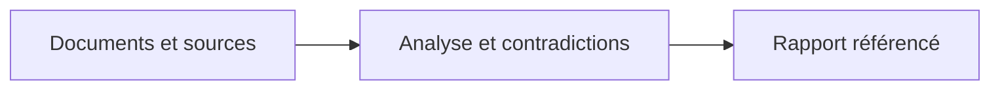

<p align="center">
 
</p>

<h1 align="center">OSINT Forge Skills</h1>

<p align="center">
 <strong>Des enquêtes OSINT et forensic avec des preuves référencées.</strong><br>
 12 skills pour les assistants IA en ligne de commande.<br>
 Claude Code · Codex · OpenCode · Gemini CLI
</p>

<p align="center">
 
 
 
 
</p>

<p align="center">
 <a href="README.md">English</a> ·
 <a href="#démarrer-en-cinq-minutes">Démarrage</a> ·
 <a href="#installer-dans-son-assistant-ia">Installation</a> ·
 <a href="#les-12-skills">Catalogue</a> ·
 <a href="docs/README.md">Documentation</a> ·
 <a href="#benchmarks">Benchmarks</a>
</p>


---

## Enquêter avec des preuves que l’on peut réexaminer

**12 skills pour aider les assistants IA à examiner les sources, confronter
les hypothèses et rédiger des rapports reliés aux pièces.** Pour les analystes,
enquêteurs, journalistes et chercheurs. Gratuit et open source, sous Apache-2.0.

Une skill associe des instructions spécialisées et des outils locaux. Vous
choisissez le client IA et le modèle ; les outils Python conservent les fichiers
sélectionnés dans un dossier portable.



**Vos entrées :** documents sélectionnés, captures de sources, journaux ou
exports d’historique navigateur. **Votre résultat :** un dossier avec les pièces
conservées, les conclusions justifiées et les inconnues explicites, à relire
puis à transmettre.

## Voir un résultat concret

**Trois articles confirment-ils un événement de façon indépendante ?** Dans
le cas synthétique Dock 7, les trois reprennent le Harbor Bulletin. L’heure
exacte de l’événement reste non confirmée.

| Aperçu de rapport · exemple synthétique résumé | Pièces |
| --- | --- |
| **Observé :** les trois articles attribuent l’annonce au même bulletin. | `E000001` · `E000002` · `E000003` |
| **Élément contradictoire à examiner :** une capture indique que le quai est ouvert ; une autre note indique que la fermeture n’a pas encore été observée. | `E000004`, journal d’événements |
| **Inconnu :** la fermeture a-t-elle commencé à 09 h 00 UTC ? L’heure annoncée n’a pas de fuseau. | `C000002`, non confirmé, confiance faible |

La démo enregistre explicitement ces conclusions et groupes d’origine ; elle
ne demande pas à un modèle de les découvrir. Des domaines ou des empreintes
différents ne prouvent pas l’indépendance des sources.
[Explorer le corpus](examples/PROVENANCE.md).

## Démarrer en cinq minutes

Depuis la **racine du dépôt source**, avec **Python 3.11+**, lancez la démo
synthétique. Aucun compte, clé API ou paquet Python supplémentaire n’est requis.

**Linux / WSL**

```bash
mkdir -p cases
python3 scripts/demo.py --out cases/demo
```

**Windows / PowerShell**

```powershell
New-Item -ItemType Directory -Force .\cases | Out-Null
py -3 scripts/demo.py --out .\cases\demo
```

Choisissez un dossier de sortie **neuf** à chaque exécution. Ouvrez
`cases/demo/case/reports/report.fr.md` : la démo enregistre **7 pièces,
2 conclusions et 2 horodatages incertains**, puis vérifie un export privé et
restaure le dossier. Elle n’utilise ni réseau ni modèle. Les libellés du rapport
sont français ; le texte des pièces et conclusions synthétiques reste anglais.

[Suivre le guide pas à pas](docs/demarrage.md) ·
[Vous utilisez une archive extraite ?](docs/demarrage.md#choose-the-right-environment)

## Installer dans son assistant IA

Construisez les paquets depuis le dépôt source avec
`python3 scripts/package.py` (`py -3 scripts/package.py` sous Windows).
Choisissez ensuite votre client :

| Client | Guide d’installation |
| --- | --- |
| Claude Code | [Plugin natif](docs/installation.md#native-claude-code-plugin) |
| Codex | [Plugin natif](docs/installation.md#native-codex-plugin) |
| OpenCode | [Skills autonomes](docs/installation.md#standalone-skills-all-four-clients) |
| Gemini CLI | [Skills autonomes ou installation native](docs/installation.md#standalone-skills-all-four-clients) |

Installez les paquets générés dans `dist/`, qui contiennent le runtime requis.
Choisissez une seule méthode par client et portée d’installation. La découverte
réelle et le comportement des modèles restent à tester ; voir
[l’état des validations](#ce-qui-est-vérifié-aujourdhui).

Après installation, exemple de demande :

> Utilise `of-case-start` sur ces documents fournis, sans requête réseau.
> Vérifie si les articles apportent une confirmation indépendante, examine
> les contradictions et prépare un rapport référencé. Garde les inconnues explicites.

## Les 12 skills

Choisissez une étape, puis la skill adaptée à votre question.

### Cadrer

- [Ouvrir un dossier](skills/of-case-start/SKILL.md) : question, périmètre et inventaire des pièces

### Vérifier les sources

- [Provenance](skills/of-source-provenance/SKILL.md) : origines et reprises
- [Infrastructure de domaine](skills/of-domain-infrastructure/SKILL.md) : captures DNS/RDAP
- [Géolocalisation](skills/of-geolocation/SKILL.md) : lieux candidats

### Examiner les fichiers

- [Triage documentaire](skills/of-document-triage/SKILL.md) : fichiers, archives et courriels
- [Analyse des médias](skills/of-media-forensics/SKILL.md) : contexte et métadonnées fournies
- [Traces navigateur](skills/of-browser-artifacts/SKILL.md) : copies d’historiques pris en charge

### Confronter les explications

- [Chronologie](skills/of-log-timeline/SKILL.md) : dates et incertitudes
- [Corrélation](skills/of-evidence-correlate/SKILL.md) : liens candidats
- [Audit d’hypothèses](skills/of-hypothesis-audit/SKILL.md) : alternatives et contradictions

### Transmettre

- [Rapport d’enquête](skills/of-investigation-report/SKILL.md) : conclusions référencées
- [Export du dossier](skills/of-case-export/SKILL.md) : partage relu ou restauration privée

## Ce qui est vérifié aujourd’hui

Version **0.1.0**, contrôles locaux consignés le **14 octobre 2026** :

| Vérifié localement sous Linux/WSL | Reste à évaluer |
| --- | --- |
| 81 tests automatisés réussis | Découverte et invocation réelles dans les quatre clients |
| 12 runtimes autonomes et 4 adaptateurs d’installation contrôlés | Qualité d’enquête des modèles et résistance aux injections de prompt |
| Export et restauration de la démo synthétique vérifiés | Exécution native Windows et macOS |

Les observations des manifestes clients sont datées du 13 octobre dans le
[registre de compatibilité](docs/compatibility.json). Les contrôles de paquets
n’établissent ni l’invocation dans un client ni la performance d’un modèle.

<a id="benchmarks"></a>

**Benchmarks :** 12/12 contrôles des outils hors ligne réussis lors de la mesure
consignée du 14 octobre. [Mesures, résultats bruts et reproduction](benchmarks/README.md).
**Pilote SkillsBench :** Codex réussit `citation-check` **3/3 avec le paquet et
3/3 sans lui**. Aucune lecture explicite de skill n’a été observée ; ce résultat
ne démontre donc pas leur apport. [Protocole, résultats et limites](benchmarks/README.md#skillsbench-pilot).

## Limites essentielles

- **Outils locaux, modèle choisi séparément.** Les helpers Python fonctionnent
  hors ligne. Un assistant distant peut transmettre ce qu’il lit ; appliquez
  sa politique de données.
- **La conservation demande une interprétation.** Les empreintes vérifient les
  octets, pas l’authenticité. Les corrélations sont des pistes ; les heures
  manquantes et historiques incomplets restent des lacunes.
- **Analyse bornée.** Exports pris en charge uniquement ; 64 Mio par fichier,
  256 Mio de pièces brutes par dossier, 4 Mio d’entrées structurées et
  5 000 événements. [Formats et limites détaillées](docs/cli.md#capabilities-and-limits).
- **Relecture avant partage.** Gardez les dossiers réels hors de ce dépôt.
  Les exports privés contiennent les pièces ; les vues publiques demandent
  une relecture et l’approbation de leurs octets exacts. Le masquage automatique
  ne garantit pas l’anonymisation.

[Modèle de sécurité](SECURITY.md) ·
[Partage et restauration](docs/cli.md#export-verification-and-restoration)

## Pour aller plus loin

[Documentation](docs/README.md) · [Commandes](docs/cli.md) ·
[Format des dossiers](docs/formats.md) · [Dépannage](docs/depannage.md)

Les guides sont en anglais et inclus dans le plugin complet. Les dossiers
suivent un [contrat versionné](shared/case-contract.md), permettant à un autre
analyste ou client de les reprendre indépendamment d’une conversation.

**[Apache-2.0](LICENSE)** · [NOTICE](NOTICE) ·
[Identité visuelle et provenance des éléments graphiques](docs/branding/README.md)

Silex et Rivet sont des mascottes promotionnelles. Les noms des clients indiquent
la compatibilité visée, sans affiliation ni recommandation d’un fournisseur.
