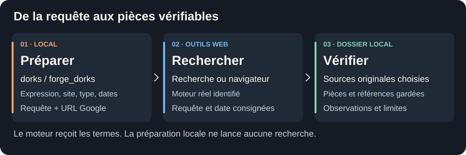
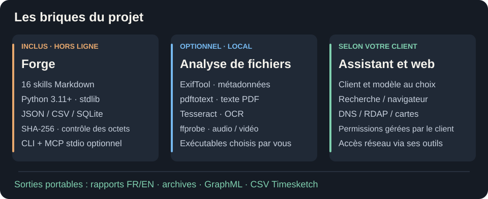

<p align="center">
 
</p>

<h1 align="center">OSINT Forge Skills</h1>

<p align="center">
 <strong>Enquêtez, vérifiez et transmettez les preuves.</strong><br>
 16 skills OSINT et forensic open source avec leurs outils locaux.<br>
 Claude Code · Codex · OpenCode · Gemini CLI
</p>

<p align="center">
 <a href="VERSION"></a>
 <a href="#les-skills"></a>
 <a href="#les-outils-utilisables"></a>
 <a href="docs/installation.md"></a>
 <a href="LICENSE"></a>
</p>

<p align="center">
 <a href="README.md">English</a> · <a href="#démarrer-en-cinq-minutes">Démarrage</a> · <a href="#les-outils-utilisables">Outils</a> · <a href="#rechercher-avec-google-dorking">Dorking</a> · <a href="#les-skills">16 skills</a> · <a href="#benchmarks">Benchmarks</a>
</p>

Transformez des sources sélectionnées en un dossier que vous pouvez relire,
reprendre et transmettre. **OSINT Forge Skills réunit des méthodes d'enquête,
des outils d'analyse locaux et un serveur MCP optionnel** pour les analystes,
les enquêteurs et les personnes qui apprennent l'OSINT. Conservez les originaux,
examinez les explications concurrentes et produisez des conclusions dont les
références peuvent être vérifiées par une autre personne.

Les skills, le runtime Python et la documentation sont **gratuits et open source
sous Apache-2.0**. Les outils locaux ne demandent ni compte, ni clé API, ni service
payant. Vous choisissez votre assistant et votre modèle, dont l'accès et les coûts
restent distincts.

## Pourquoi utiliser OSINT Forge Skills ?

| Votre avantage | Ce que le projet apporte |
| --- | --- |
| **Retrouver chaque élément cité** | Originaux conservés, sources référencées et citations de pages, lignes, enregistrements ou intervalles complets de sous-titres |
| **Garder les incertitudes visibles** | Hypothèses alternatives, contradictions, examen de l'origine des sources et lacunes explicites |
| **Reprendre avec une prochaine étape claire** | Plans par phases, file de relecture priorisée et historique des corrections sans effacer les conclusions précédentes |
| **Choisir vos outils** | Bibliothèque standard Python hors ligne, aucune télémétrie du runtime, aucun fournisseur obligatoire ni installation automatique |
| **Transmettre un travail exploitable** | Rapports HTML privés avec recherche en français/anglais, export/restauration vérifiés, GraphML et CSV aux champs Timesketch |


## Ce que vous pouvez faire

| Votre point de départ | Ce que vous pouvez produire |
| --- | --- |
| **Un index CDX Wayback** | Une sélection datée d'entrées de captures pour une URL précise, avec les références des lignes sources. Comparez les pages fournies séparément. |
| **Un export JSON BODACC** | Une chronologie de publications par SIREN, avec dates de publication et d'acte séparées et exports partiels signalés. |
| **Des sous-titres SRT ou WebVTT** | Des passages référencés avec intervalles, lignes sources et contexte déclaré de transcription ou de traduction. |
| **Des documents, journaux et exports navigateur ou Windows** | Un tri des fichiers, des chronologies et des observations liées aux pièces, avec les formats non pris en charge signalés. |
| **Des publications ou traces d'agents fournies** | Des comparaisons de sources, des contradictions documentées et une distinction entre actions déclarées et effets vérifiés. |

Ces parcours analysent localement les fichiers sélectionnés. La récupération
d'archives, les requêtes de registres et les recherches web utilisent les outils
autorisés du client. Le contrôle des sous-titres vérifie le texte enregistré,
pas les paroles prononcées. [Formats et commandes](docs/cli.md).

<a id="démarrer-en-cinq-minutes"></a>

## Essayer un dossier

Depuis la racine du dépôt source ou du plugin complet extrait, avec
**Python 3.11+** et un dossier de sortie neuf :

```bash
mkdir -p cases
python3 examples/public_imports_demo.py --out cases/public-imports-demo
```

Ouvrez **`cases/public-imports-demo/case/reports/report.fr.html`**.
La démo synthétique contient un index Wayback, un export BODACC et des sous-titres,
vérifie **trois citations**, puis exporte et restaure le dossier privé.
Aucun modèle, compte ou accès réseau n'est nécessaire. Les libellés sont français,
le corpus reste anglais.

<details>
<summary>Windows / PowerShell et autres démonstrations</summary>

```powershell
New-Item -ItemType Directory -Force .\cases | Out-Null
py -3 examples/public_imports_demo.py --out .\cases\public-imports-demo
```

| Démo | Ce qu'elle montre |
| --- | --- |
| [Premier dossier](docs/demarrage.md#full-demo-from-source) | Sept pièces, deux conclusions et une origine de publication commune |
| [Corrections et relecture visuelle](docs/demarrage.md#review-a-corrected-case-visually) | Historique, événements annotés, relations candidates et formats d'échange |
| [Dépendances et citations](docs/demarrage.md#review-dependencies-and-citations) | Conclusions à réexaminer et citation volontairement incorrecte |

Ces exemples sont préétablis à partir de pièces synthétiques originales.
Ils ne mesurent pas la qualité d'enquête d'un modèle.

</details>

<a id="les-outils-utilisables"></a>

## Ce qui est inclus

| Composant | Ce que vous obtenez |
| --- | --- |
| **16 skills** | Méthodes d'enquête, parcours spécialisés et règles de traitement des pièces pour votre assistant |
| **CLI Forge** | Import, analyse, comparaison, relecture, rapports et exports de dossiers portables en local |
| **MCP stdio optionnel** | Cinq outils de planification/recherche, des ressources méthodologiques et deux outils limités aux compteurs pour un dossier choisi au démarrage |
| **Quatre adaptateurs optionnels** | ExifTool pour les métadonnées, pdftotext pour les PDF, Tesseract pour l'OCR et ffprobe pour les métadonnées audio/vidéo |

Chaque dossier de skill complet contient son runtime, ses guides, sa licence et
sa notice. Vous installez et choisissez les exécutables optionnels. Leurs résultats
conservent l'empreinte de la pièce, la version de l'outil et les paramètres.
[Parcours des outils](shared/tool-workflows.md) · [Référence CLI](docs/cli.md)
· [Configuration MCP](docs/mcp.md).

## Rechercher avec Google dorking

Préparez des requêtes ciblées localement, puis lancez-les avec les outils web
autorisés de votre assistant. Des fiches de sources datées et six parcours de
rebond aident à choisir le prochain contrôle. Le runtime ne soumet pas les
recherches et ne collecte pas de pages.

```bash
python3 scripts/forge.py dorks --phrase "Harbor Example Ltd" --site example.org --filetype pdf
```

L'exemple utilise une organisation fictive et un domaine réservé.
[Parcours de recherche et opérateurs](shared/research-workflows.md#google-dorking-with-host-web-tools).

<details>
<summary>Parcours de recherche et composants techniques</summary>



## Les briques du projet



Le runtime et les parcours sont originaux. Des approches de recherche examinées
inspirent certaines méthodes, sans embarquer les runtimes ou services OSINT tiers.
[Références et attribution](shared/research-workflows.md#design-references).

</details>

<a id="installer-dans-son-assistant-ia"></a>

## Connecter votre assistant

[Copiez un skill complet ou utilisez le CLI Skills](docs/installation.md#direct-installation-with-the-skills-cli).
Construisez les archives des plugins natifs depuis les sources avec
`python3 scripts/package.py`.

| Claude Code | Codex | OpenCode · Gemini CLI |
| :---: | :---: | :---: |
| [Plugin natif](docs/installation.md#native-claude-code-plugin) | [Plugin natif](docs/installation.md#native-codex-plugin) | [Skills autonomes](docs/installation.md#standalone-skills-all-four-clients) |

> Utilise of-case-start sur ces documents fournis. Conserve les originaux,
> examine les contradictions et prépare un rapport référencé. Garde les inconnues explicites.

Les modes d'installation et les essais observés dans les clients sont documentés
séparément. [Registre de compatibilité](docs/compatibility.json).

<a id="les-12-skills"></a>
<a id="les-skills"></a>

## Choisir une étape d'enquête

| Étape | Skills |
| --- | --- |
| **Cadrer** | [Démarrage du dossier](skills/of-case-start/SKILL.md) |
| **Vérifier les sources** | [Provenance](skills/of-source-provenance/SKILL.md) · [Domaines](skills/of-domain-infrastructure/SKILL.md) · [Organisations](skills/of-organization-research/SKILL.md) · [Géolocalisation](skills/of-geolocation/SKILL.md) |
| **Examiner les fichiers** | [Documents](skills/of-document-triage/SKILL.md) · [Médias](skills/of-media-forensics/SKILL.md) · [Historique navigateur](skills/of-browser-artifacts/SKILL.md) · [Exports Windows](skills/of-windows-artifacts/SKILL.md) · [Exports d'agents](skills/of-agent-artifacts/SKILL.md) |
| **Tester les explications** | [Chronologie](skills/of-log-timeline/SKILL.md) · [Corrélation](skills/of-evidence-correlate/SKILL.md) · [Hypothèses](skills/of-hypothesis-audit/SKILL.md) · [Comparaison de versions](skills/of-version-compare/SKILL.md) |
| **Transmettre** | [Rapport](skills/of-investigation-report/SKILL.md) · [Export](skills/of-case-export/SKILL.md) |

<a id="ce-qui-est-vérifié-aujourdhui"></a>
<a id="benchmarks"></a>

## Tests et benchmarks

**26 octobre 2026, snapshot runtime `271ca22` : 296 tests réussis sous Linux/WSL,
dont 22 tests sur les exports publics et les transcriptions.** Les 16 skills générés
et les 682 fichiers de distribution ont été contrôlés. La nouvelle démo fonctionne
depuis le plugin extrait, et les trois nouvelles commandes depuis un skill autonome
en Python isolé.

La version du paquet reste **0.3.0**, avec les derniers ajouts dans la section
**Unreleased** du [changelog](CHANGELOG.md). Les dossiers utilisent le schéma **4**.

- Les précédents contrôles avec le SDK MCP officiel ont réussi. Des suites ciblées
  Windows natives ont aussi réussi sur le snapshot du 25 octobre, avec deux tests
  de liens symboliques ignorés par version de Python.
- Les essais historiques de clients et modèles restent consultables avec leur
  périmètre exact. Ils ne démontrent pas de gain général de précision, de vitesse
  ou de coût de tokens.
- Les API réelles, la couverture complète des clients et systèmes, la résistance
  générale aux injections et l'exactitude audio ne sont pas établies par ces tests locaux.

[Reproduire une démo et consulter les résultats](benchmarks/README.md)
· [Compatibilité datée et limites](docs/compatibility.json).

**Avant de traiter des pièces réelles :** votre client contrôle ce qu'un modèle
distant reçoit. Les empreintes vérifient les octets, pas l'authenticité. Relisez les
exports avant partage. Le masquage seul ne garantit pas l'anonymisation.
[Sécurité](SECURITY.md).

## Participer au projet

[Ouvrez une issue](https://github.com/OSINT-Forge-Community/osint-forge-skills/issues)
pour un retour, un bug reproductible ou une proposition de parcours.
[Guide de contribution](CONTRIBUTING.md).

Sécurité : [security@osint-forge.com](mailto:security@osint-forge.com)<br>
Données personnelles : [privacy@osint-forge.com](mailto:privacy@osint-forge.com)

---

[Documentation](docs/README.md) · [CLI](docs/cli.md) · [Dépannage](docs/depannage.md) · [Version du paquet](VERSION) · [Changelog](CHANGELOG.md)

Logiciel, skills et textes : **[Apache-2.0](LICENSE)** · [NOTICE](NOTICE).<br>
Visuels © OSINT Forge, tous droits réservés. [Provenance](docs/branding/README.md).<br>
Silex et Rivet sont des mascottes promotionnelles. Les noms des clients n'impliquent aucune affiliation ni recommandation.
