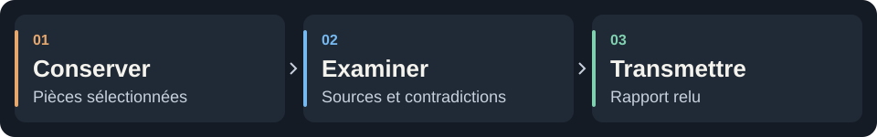

<p align="center">
 
</p>

<h1 align="center">OSINT Forge Skills</h1>

<p align="center">
 <strong>Des sources aux conclusions. Gardez les preuves.</strong><br>
 15 skills OSINT et forensic pour les assistants IA.<br>
 Claude Code · Codex · OpenCode · Gemini CLI
</p>

<p align="center">
 <a href="VERSION"></a>
 <a href="#les-skills"></a>
 <a href="#les-outils-utilisables"></a>
 <a href="docs/installation.md"></a>
 <a href="LICENSE"></a>
</p>

<p align="center">
 <a href="README.md">English</a> · <a href="#démarrer-en-cinq-minutes">Démarrage</a> · <a href="#les-outils-utilisables">Outils</a> · <a href="#les-skills">15 skills</a> · <a href="#benchmarks">Benchmarks</a>
</p>

Documents, captures de sources, journaux et exports d’historique deviennent un
dossier portable : pièces conservées, conclusions référencées et inconnues explicites.
Vous choisissez l’assistant et le modèle ; les outils Python inclus restent hors ligne.



<a id="démarrer-en-cinq-minutes"></a>

## Essayer un dossier

Depuis la racine du dépôt source, avec **Python 3.11+**. Aucun compte ni clé API requis.

```bash
mkdir -p cases
python3 scripts/demo.py --out cases/demo
```

<details>
<summary>Windows / PowerShell</summary>

```powershell
New-Item -ItemType Directory -Force .\cases | Out-Null
py -3 scripts/demo.py --out .\cases\demo
```

</details>

Utilisez un dossier de sortie **neuf**. Ouvrez `cases/demo/case/reports/report.fr.md`.
La démo hors ligne enregistre **7 pièces et 2 conclusions**, puis vérifie un export
et sa restauration. Les libellés sont français, le corpus reste anglais.
[Guide pas à pas →](docs/demarrage.md)

> **Trois articles. Une seule source initiale.** Dans le cas synthétique Dock 7,
> trois articles reprennent le même bulletin ; l’heure exacte reste inconnue.
> Ces conclusions sont préétablies, pas découvertes par un modèle. [Explorer le cas](examples/PROVENANCE.md).

**Relire un dossier corrigé :** lancez
`python3 examples/review_demo.py --out cases/review-demo`, puis ouvrez
`cases/review-demo/case/reports/report.fr.html`. L’exemple synthétique présente
les références précises, l’historique des corrections, les recherches incomplètes,
les événements annotés et les relations candidates. [Guide de relecture et d’échange](shared/review-workflows.md).

<a id="les-outils-utilisables"></a>

## Les outils à disposition

| Outil | Utilisation |
| --- | --- |
| **Forge · inclus** | Conserver les pièces, trier, créer des chronologies, corréler et exporter |
| **ExifTool · optionnel** | Métadonnées PNG, JPEG et PDF |
| **pdftotext · optionnel** | Texte d’une sélection de pages PDF |
| **Tesseract · optionnel** | OCR sur les images PNG/JPEG |
| **ffprobe · optionnel** | Métadonnées des conteneurs et flux audio/vidéo |

```bash
python3 scripts/forge.py tools
python3 scripts/forge.py plan --kind organization
```

Les quatre adaptateurs sont inclus ; **vous installez et choisissez les exécutables tiers**.
Chaque résultat conserve l’empreinte de la pièce, la version de l’outil, ses paramètres et sa sortie.
L’import groupé garde la provenance de chaque fichier. Analysez les captures
HTML/MHTML fournies, comparez des versions texte, mappez les colonnes d’un CSV
forensic et exportez en GraphML ou en CSV aux champs Timesketch.
La réutilisation explicite d’un résultat reste distincte d’une nouvelle exécution.
Recherche web, DNS/RDAP et cartes dépendent des outils disponibles et autorisés du client.
[Commandes et limites](docs/cli.md#optional-local-tools) · [Workflows des outils](shared/tool-workflows.md)

<a id="installer-dans-son-assistant-ia"></a>

## Connecter son assistant

Construisez avec `python3 scripts/package.py`, puis installez depuis `dist/` :

| Claude Code | Codex | OpenCode · Gemini CLI |
| :---: | :---: | :---: |
| [Plugin natif](docs/installation.md#native-claude-code-plugin) | [Plugin natif](docs/installation.md#native-codex-plugin) | [Skills autonomes](docs/installation.md#standalone-skills-all-four-clients) |

> Utilise `of-case-start` sur ces documents, sans requête réseau.
> Vérifie l’indépendance des sources, examine les contradictions et prépare un rapport référencé.

<a id="les-12-skills"></a>
<a id="les-skills"></a>

## Choisir son étape d’enquête

| Étape | Skills |
| --- | --- |
| **Cadrer** | [Ouvrir un dossier](skills/of-case-start/SKILL.md) |
| **Vérifier les sources** | [Provenance](skills/of-source-provenance/SKILL.md) · [Domaines](skills/of-domain-infrastructure/SKILL.md) · [Organisations](skills/of-organization-research/SKILL.md) · [Géolocalisation](skills/of-geolocation/SKILL.md) |
| **Examiner les fichiers** | [Documents](skills/of-document-triage/SKILL.md) · [Médias](skills/of-media-forensics/SKILL.md) · [Historique navigateur](skills/of-browser-artifacts/SKILL.md) · [Exports Windows](skills/of-windows-artifacts/SKILL.md) |
| **Confronter les explications** | [Chronologie](skills/of-log-timeline/SKILL.md) · [Corrélation](skills/of-evidence-correlate/SKILL.md) · [Hypothèses](skills/of-hypothesis-audit/SKILL.md) · [Comparaison de versions](skills/of-version-compare/SKILL.md) |
| **Transmettre** | [Rapport](skills/of-investigation-report/SKILL.md) · [Export](skills/of-case-export/SKILL.md) |

<a id="ce-qui-est-vérifié-aujourdhui"></a>
<a id="benchmarks"></a>

## Tests et benchmarks

Consigné le **14 octobre 2026** : **117 tests réussis** sous Linux/WSL, dont
**15 tests synthétiques des adaptateurs**. [Benchmarks et essais réels →](benchmarks/README.md)

<details>
<summary>Périmètre des contrôles et essais restant à réaliser</summary>

- 15 runtimes autonomes, 4 adaptateurs d’installation, export et restauration de la démo.
- Quatre exécutables forensic réels et le lecteur HTML FR/EN vérifiés sur des données synthétiques en conteneur Linux.
- Six sessions de revue Codex terminées ; les skills du projet ont été lus dans les trois
  sessions qui en disposaient. Les deux conditions donnent des conclusions acceptées, sans gain de qualité démontré.
- Les résultats historiques hors ligne et SkillsBench restent disponibles avec leurs limites.
- La couverture de tous les skills et clients, la qualité générale d’enquête, la résistance aux injections,
  Windows/macOS natifs et les imports dans des applications tierces restent à valider.
- Les observations des manifestes sont datées dans le [registre de compatibilité](docs/compatibility.json).
  Les résultats historiques s’appliquent à leurs snapshots de sources.

</details>

**Avant de traiter des pièces réelles :** un assistant distant peut transmettre ce qu’il lit.
Les empreintes vérifient les octets, pas l’authenticité. Relisez les exports avant partage ;
le masquage ne garantit pas l’anonymisation. [Sécurité](SECURITY.md) · [Formats et limites](docs/cli.md#capabilities-and-limits)

## Participer au projet

Avis, bug ou amélioration ? **[Ouvrez une issue](https://github.com/OSINT-Forge-Community/osint-forge-skills/issues)**
et choisissez un label. [Guide de contribution](CONTRIBUTING.md)

Sécurité : [security@osint-forge.com](mailto:security@osint-forge.com)<br>
Données personnelles : [privacy@osint-forge.com](mailto:privacy@osint-forge.com)

---

[Documentation](docs/README.md) · [CLI](docs/cli.md) · [Dépannage](docs/depannage.md) · [Version du paquet](VERSION) · [Changelog](CHANGELOG.md)

Logiciel, skills et textes : **[Apache-2.0](LICENSE)** · [NOTICE](NOTICE).<br>
Visuels © OSINT Forge, tous droits réservés. [Provenance](docs/branding/README.md).<br>
Silex et Rivet sont des mascottes promotionnelles. Les noms des clients n’impliquent aucune affiliation ni recommandation.
