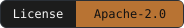
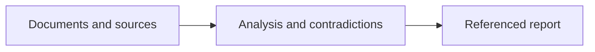

<p align="center">
 
</p>

<h1 align="center">OSINT Forge Skills</h1>

<p align="center">
 <strong>OSINT and forensic investigations with referenced evidence.</strong><br>
 12 skills for AI command-line assistants.<br>
 Claude Code · Codex · OpenCode · Gemini CLI
</p>

<p align="center">
 
 
 
 
</p>

<p align="center">
 <a href="README.fr.md">Français</a> ·
 <a href="#start-in-five-minutes">Quick start</a> ·
 <a href="#install-in-your-ai-assistant">Installation</a> ·
 <a href="#the-12-skills">Catalogue</a> ·
 <a href="docs/README.md">Documentation</a> ·
 <a href="#benchmarks">Benchmarks</a>
</p>


---

## Investigate with evidence you can revisit

**12 skills that help AI assistants examine sources, challenge hypotheses and
write reports linked to evidence.** For analysts, investigators, journalists
and researchers. Free and open source, under Apache-2.0.

A skill combines specialized instructions and local tools. You choose the AI
client and model; the Python tools preserve selected files in a portable case.



**Your inputs:** selected documents, source captures, logs or browser-history
exports. **Your output:** a case with preserved evidence, reasoned findings
and explicit unknowns, ready for review and handoff.

## See a concrete result

**Do three articles confirm the same event independently?** In the synthetic
Dock 7 case, all three repeat the Harbor Bulletin. The event's exact time
remains unconfirmed.

| Report preview · synthetic example, summarized | Evidence |
| --- | --- |
| **Observed:** all three articles attribute the announcement to the same bulletin. | `E000001` · `E000002` · `E000003` |
| **Counterpoint to check:** a status capture says the dock is open; another note says closure has not yet been observed. | `E000004`, event log |
| **Unknown:** whether closure began at 09:00 UTC. The announced time has no timezone. | `C000002`, unconfirmed, low confidence |

The demo records these claims and origin labels explicitly; it does not ask a
model to discover them. Different domains or hashes alone do not prove source
independence. [Explore the corpus](examples/PROVENANCE.md).

## Start in five minutes

From the **source repository root**, with **Python 3.11+**, run the synthetic
demo. No account, API key or additional Python package is needed.

**Linux / WSL**

```bash
mkdir -p cases
python3 scripts/demo.py --out cases/demo
```

**Windows / PowerShell**

```powershell
New-Item -ItemType Directory -Force .\cases | Out-Null
py -3 scripts/demo.py --out .\cases\demo
```

Use a **new** output directory each time. Open
`cases/demo/case/reports/report.en.md`: the demo registers **7 pieces of
evidence, 2 claims and 2 uncertain timestamps**, then verifies a private
export and restores it. It uses no network or model.

[Follow the walkthrough](docs/demarrage.md) ·
[Using an extracted package?](docs/demarrage.md#choose-the-right-environment)

## Install in your AI assistant

Build the packages from the source repository with
`python3 scripts/package.py` (`py -3 scripts/package.py` on Windows).
Then choose your client:

| Client | Installation guide |
| --- | --- |
| Claude Code | [Native plugin](docs/installation.md#native-claude-code-plugin) |
| Codex | [Native plugin](docs/installation.md#native-codex-plugin) |
| OpenCode | [Standalone skills](docs/installation.md#standalone-skills-all-four-clients) |
| Gemini CLI | [Standalone skills or native skill installation](docs/installation.md#standalone-skills-all-four-clients) |

Install generated packages from `dist/`; they contain the required runtime.
Use one installation route per client and scope. Actual discovery and model
behavior remain untested; see [validation status](#what-has-been-verified).

Once installed, an example request is:

> Use `of-case-start` on these supplied documents, without network requests.
> Check whether the articles provide independent confirmation, examine
> contradictions and prepare a referenced report. Keep unknowns explicit.

## The 12 skills

Choose a stage, then the skill that matches your question.

### Scope

- [Case start](skills/of-case-start/SKILL.md): question, scope and evidence inventory

### Check sources

- [Source provenance](skills/of-source-provenance/SKILL.md): origins and repeated reporting
- [Domain infrastructure](skills/of-domain-infrastructure/SKILL.md): DNS/RDAP captures
- [Geolocation](skills/of-geolocation/SKILL.md): candidate places

### Examine files

- [Document triage](skills/of-document-triage/SKILL.md): files, archives and email
- [Media forensics](skills/of-media-forensics/SKILL.md): context and supplied metadata
- [Browser artifacts](skills/of-browser-artifacts/SKILL.md): supported history copies

### Test explanations

- [Log timeline](skills/of-log-timeline/SKILL.md): dates and uncertainty
- [Evidence correlation](skills/of-evidence-correlate/SKILL.md): candidate links
- [Hypothesis audit](skills/of-hypothesis-audit/SKILL.md): alternatives and contradictions

### Hand off

- [Investigation report](skills/of-investigation-report/SKILL.md): referenced findings
- [Case export](skills/of-case-export/SKILL.md): reviewed sharing or private restoration

## What has been verified

Version **0.1.0**, local checks recorded on **October 14, 2026**:

| Checked locally on Linux/WSL | Still to evaluate |
| --- | --- |
| 81 automated tests passed | Real skill discovery and invocation in the four clients |
| 12 standalone runtimes and 4 installation adapters checked | Model investigation quality and prompt-injection resistance |
| Synthetic demo export and restoration verified | Native Windows and macOS execution |

Client manifest observations are dated October 13 in the
[compatibility ledger](docs/compatibility.json). Packaging checks establish
neither client invocation nor model performance.

<a id="benchmarks"></a>

**Benchmarks:** 12/12 offline helper probes passed in the recorded October 14
run. [Measurements, raw results and reproduction](benchmarks/README.md).
**SkillsBench pilot:** Codex passed `citation-check` **3/3 with the package and
3/3 without it**. No explicit skill read was observed, so this does not demonstrate
a skill benefit. [Protocol, results and limits](benchmarks/README.md#skillsbench-pilot).

## Essential limits

- **Local tools, independently chosen model.** Python helpers work offline.
  A remote assistant may transmit the content it reads; apply its data policy.
- **Preservation requires interpretation.** Hashes check bytes, not authenticity.
  Correlations are leads, and missing times or incomplete histories remain gaps.
- **Bounded analysis.** Supported exports only; 64 MiB per file, 256 MiB of raw
  evidence per case, 4 MiB structured inputs and 5,000 events.
  [Formats and full limits](docs/cli.md#capabilities-and-limits).
- **Review before sharing.** Keep real cases outside this repository. Private
  exports contain evidence; public views require review and exact-byte approval.
  Automatic masking does not guarantee anonymization.

[Security model](SECURITY.md) ·
[Sharing and restoration](docs/cli.md#export-verification-and-restoration)

## Go further

[Documentation](docs/README.md) · [Commands](docs/cli.md) ·
[Case format](docs/formats.md) · [Troubleshooting](docs/depannage.md)

Guides are in English and included in the full plugin. Cases use a shared
[versioned contract](shared/case-contract.md) so another analyst or client can
resume them independently of a conversation.

**[Apache-2.0](LICENSE)** · [NOTICE](NOTICE) ·
[Visual identity and asset provenance](docs/branding/README.md)

Silex and Rivet are promotional mascots. Client names describe intended
compatibility and imply no affiliation or endorsement.
