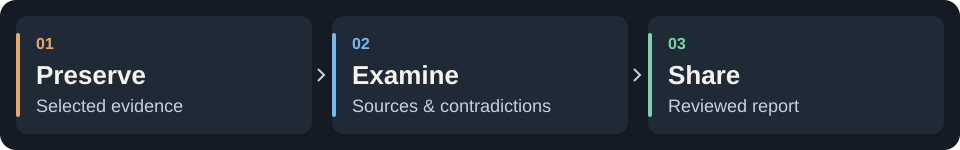
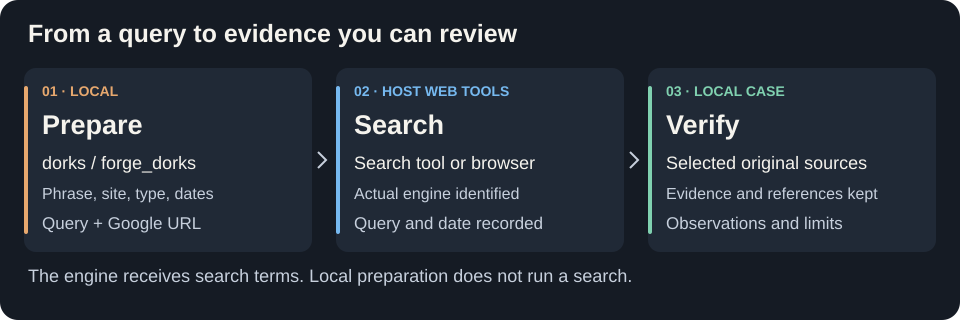
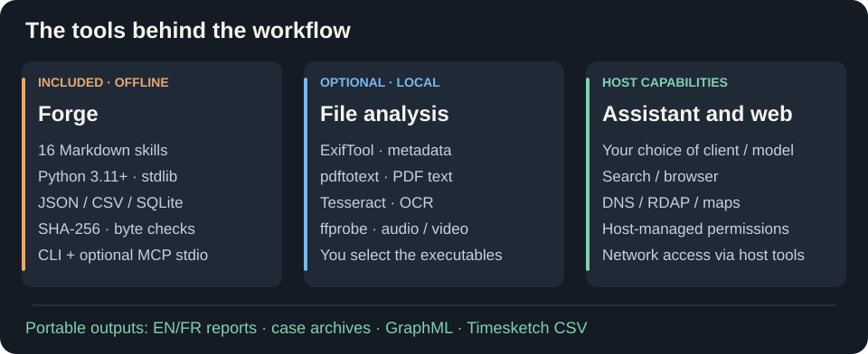

<p align="center">
 
</p>

<h1 align="center">OSINT Forge Skills</h1>

<p align="center">
 <strong>From sources to findings. Keep the evidence.</strong><br>
 16 OSINT &amp; forensic skills for AI assistants.<br>
 Claude Code · Codex · OpenCode · Gemini CLI
</p>

<p align="center">
 <a href="VERSION"></a>
 <a href="#the-skills"></a>
 <a href="#tools-you-can-use"></a>
 <a href="docs/installation.md"></a>
 <a href="LICENSE"></a>
</p>

<p align="center">
 <a href="README.fr.md">Français</a> · <a href="#start-in-five-minutes">Quick start</a> · <a href="#tools-you-can-use">Tools</a> · <a href="#search-with-google-dorking">Dorking</a> · <a href="#the-skills">16 skills</a> · <a href="#benchmarks">Benchmarks</a>
</p>

Documents, source captures, logs and browser-history exports become a portable
case with preserved evidence, referenced findings and explicit unknowns.
Use your assistant's web tools to research public sources, then preserve and
review selected evidence locally. You choose the assistant and model; the
included Python runtime works offline.

## Why use OSINT Forge Skills?

| Advantage | What you get |
| --- | --- |
| **Traceable findings** | Preserved originals, byte checks, source references and citation locators you can revisit |
| **Structured review** | Competing hypotheses, contradictions, source independence and claims flagged when their premises change |
| **Actionable handoff** | A prioritized review queue with evidence references and suggested skills; a searchable private HTML dashboard in English or French |
| **Focused research** | Dated source cards, six pivot workflows and Google dorking to prepare the next public-source check |
| **Local control** | Python standard library, no runtime telemetry, no mandatory service and no automatic tool installation |
| **Portable work** | Self-contained skills, private case export/restore, EN/FR reports, GraphML and Timesketch-field CSV |

These are implemented capabilities. The recorded model trials do not establish
a general gain in accuracy, speed or token cost. Your host controls model access
and data transmission. [Tests and limits](#benchmarks).



<a id="start-in-five-minutes"></a>

## Try a case

From the source repository root, with **Python 3.11+**. No account or API key needed.

```bash
mkdir -p cases
python3 scripts/demo.py --out cases/demo
```

<details>
<summary>Windows / PowerShell</summary>

```powershell
New-Item -ItemType Directory -Force .\cases | Out-Null
py -3 scripts/demo.py --out .\cases\demo
```

</details>

Use a **new** output directory. Open `cases/demo/case/reports/report.en.md`.
The offline demo registers **7 evidence items and 2 claims**, then verifies an
export and restoration. [Walkthrough →](docs/demarrage.md)

> **Three articles. One original source.** In the synthetic Dock 7 case,
> three articles repeat the same bulletin; the event's exact time stays unknown.
> These findings are scripted, not discovered by a model. [Explore the case](examples/PROVENANCE.md).

**Review a corrected case visually:** run
`python3 examples/review_demo.py --out cases/review-demo`, then open
`cases/review-demo/case/reports/report.en.html`. The synthetic example includes
precise references, correction history, research gaps, annotated events and
candidate relations. [Review and exchange guide](shared/review-workflows.md).

**Review dependencies and citations:** run
`python3 examples/assurance_demo.py --out cases/assurance-demo` and open its
EN/FR HTML report. Run `python3 scripts/forge.py review-queue --case cases/assurance-demo/case`
for prioritized next checks. The demo shows transitive review warnings, declared coverage,
source-record references and one intentional excerpt mismatch.
[Planning and review](shared/assurance-workflows.md) · [Dated source cards](shared/source-workflows.md).

<a id="tools-you-can-use"></a>

## Tools at your fingertips

| Tool | Use it for |
| --- | --- |
| **Forge · included** | Preserve evidence, triage files, build timelines, correlate and export |
| **Google dorking · included** | Compose targeted queries and search URLs; execute with authorized host web tools |
| **MCP stdio · included, optional** | Expose five local planning/research helpers; optionally verify one selected case |
| **ExifTool · optional** | PNG, JPEG and PDF metadata |
| **pdftotext · optional** | Text from selected PDF pages |
| **Tesseract · optional** | OCR on PNG/JPEG images |
| **ffprobe · optional** | Audio/video container and stream metadata |

```bash
python3 scripts/forge.py tools
python3 scripts/forge.py plan --kind organization
```

Four adapters are included; **install and select the external executables yourself**.
Saved results retain the source hash, tool version, arguments and output.
Batch intake keeps each file's provenance. Review supplied HTML/MHTML, compare
text versions, map forensic CSV and export GraphML or Timesketch-field CSV.
Explicit result reuse is labelled separately from a fresh tool execution.
Web search, DNS/RDAP and maps depend on your client's available, authorized tools.
[Commands & limits](docs/cli.md#optional-local-tools) · [Tool workflows](shared/tool-workflows.md)

**Follow a lead:** six advisory pivot cards and an offline query generator help
choose the next check, with prerequisites and stopping conditions.
[Research workflows](shared/research-workflows.md).

**Use MCP:** enable the local server explicitly in your host to access plans,
source cards, pivots, query templates and dorks. Select one case at startup for
an additional count-only verification tool. [MCP setup](docs/mcp.md).

## Search with Google dorking



Prepare a query locally:

```bash
python3 scripts/forge.py dorks --phrase "Harbor Example Ltd" --site example.org --filetype pdf --after 2024-01-01
```

The JSON result includes `site:example.org "Harbor Example Ltd" filetype:pdf
after:2024-01-01` and an encoded Google URL. Add `--before` or repeat `--exclude`
to refine it. This example uses a synthetic name and a reserved domain.

Ask your assistant to **run the query with its authorized search or browser tool**,
record the actual engine, query and date, then check the original sources.
The included `forge_dorks` MCP tool prepares the same output. A host may use a
different engine; Google syntax support must then be checked. Without a web
tool, the query and URL remain available for manual use.
[Operator guide and execution workflow](shared/research-workflows.md#google-dorking-with-host-web-tools).

## What powers the project



The public runtime and workflows are original. Our staged research and pivot
design draws on reviewed approaches from `smixs/osint-skill`,
`frangelbarrera/osint-agent-skills` and OpenOSINT; their code and services are
not bundled dependencies. [References and attribution](shared/research-workflows.md#design-references).

<a id="install-in-your-ai-assistant"></a>

## Connect your assistant

Each complete folder in `skills/` is directly installable with its local runtime.
[Copy a skill or use the Skills CLI →](docs/installation.md#direct-installation-with-the-skills-cli)

For native plugins and ZIP archives, build with `python3 scripts/package.py`, then install from `dist/`:

| Claude Code | Codex | OpenCode · Gemini CLI |
| :---: | :---: | :---: |
| [Native plugin](docs/installation.md#native-claude-code-plugin) | [Native plugin](docs/installation.md#native-codex-plugin) | [Standalone skills](docs/installation.md#standalone-skills-all-four-clients) |

> Use `of-case-start` on these supplied documents, without network requests.
> Check source independence, examine contradictions and prepare a referenced report.

<a id="the-12-skills"></a>
<a id="the-skills"></a>

## Pick your investigation stage

| Stage | Skills |
| --- | --- |
| **Scope** | [Case start](skills/of-case-start/SKILL.md) |
| **Check sources** | [Provenance](skills/of-source-provenance/SKILL.md) · [Domains](skills/of-domain-infrastructure/SKILL.md) · [Organizations](skills/of-organization-research/SKILL.md) · [Geolocation](skills/of-geolocation/SKILL.md) |
| **Examine files** | [Documents](skills/of-document-triage/SKILL.md) · [Media](skills/of-media-forensics/SKILL.md) · [Browser history](skills/of-browser-artifacts/SKILL.md) · [Windows exports](skills/of-windows-artifacts/SKILL.md) · [Agent event exports](skills/of-agent-artifacts/SKILL.md) |
| **Test explanations** | [Timeline](skills/of-log-timeline/SKILL.md) · [Correlation](skills/of-evidence-correlate/SKILL.md) · [Hypotheses](skills/of-hypothesis-audit/SKILL.md) · [Version comparison](skills/of-version-compare/SKILL.md) |
| **Hand off** | [Report](skills/of-investigation-report/SKILL.md) · [Export](skills/of-case-export/SKILL.md) |

<a id="what-has-been-verified"></a>
<a id="benchmarks"></a>

## Tests & benchmarks

Version **0.3.0** adds coherent exports, archive-free selected installation,
phased planning, schema 4 hypotheses/tests/origins, qualified PDF page citations
and direct derived-text comparison. The optional MCP exposes static methods,
validated output contracts and bounded cancellable case operations.
See [commands and limits](docs/cli.md#schema-4-investigation-workflow),
[MCP qualification](docs/mcp.md) and the dated [compatibility ledger](docs/compatibility.json).

Recorded on **October 15, 2026**: **166 tests passed** on Linux/WSL, including
**15 synthetic adapter tests**. [Benchmarks and real trials →](benchmarks/README.md)

<details>
<summary>What these checks cover, and what remains untested</summary>

- 16 standalone runtimes, 4 installation adapters, schema 3 review, citation checks, demo export and restoration.
- Nine new Codex sessions completed across three conditions; content criteria were accepted in all nine,
  with one workspace deviation. Skills were read in all three sessions using them; no general quality gain is demonstrated.
- GraphML passed a NetworkX 3.7 round trip. Earlier real-binary, browser and six-session
  review observations retain their October 14 snapshots.
- Google dork construction and MCP stdio pass local tests; live engine effectiveness and real MCP host integration remain untested.
- Four new EN/FR SVG diagrams were rendered and inspected locally; GitHub rendering was not exercised.
- Historical offline and SkillsBench results remain available with their limitations.
- Full catalogue/client coverage, general investigation quality, prompt-injection resistance,
  native Windows/macOS and real third-party application imports remain unvalidated.
- Manifest observations are dated in the [compatibility ledger](docs/compatibility.json).
  Historical results apply to their recorded source snapshots.

</details>

**Before using real evidence:** a remote assistant may transmit what it reads.
Hashes check bytes, not authenticity. Review exports before sharing; masking
is not guaranteed anonymization. [Security](SECURITY.md) · [Supported formats & limits](docs/cli.md#capabilities-and-limits)

## Help shape the project

Ideas, bugs or improvements? **[Open an issue](https://github.com/OSINT-Forge-Community/osint-forge-skills/issues)**
and choose a label. [Contribution guide](CONTRIBUTING.md)

Security: [security@osint-forge.com](mailto:security@osint-forge.com)<br>
Personal data: [privacy@osint-forge.com](mailto:privacy@osint-forge.com)

---

[Documentation](docs/README.md) · [CLI](docs/cli.md) · [Troubleshooting](docs/depannage.md) · [Package version](VERSION) · [Changelog](CHANGELOG.md)

Software, skills and text: **[Apache-2.0](LICENSE)** · [NOTICE](NOTICE).<br>
Visuals © OSINT Forge, all rights reserved. [Asset provenance](docs/branding/README.md).<br>
Silex and Rivet are promotional mascots. Client names imply no affiliation or endorsement.
