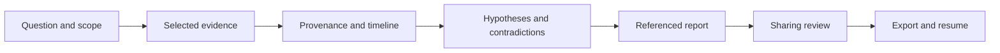

<p align="center">
 
</p>

<h1 align="center">OSINT Forge Skills</h1>

<p align="center">
 <strong>OSINT and forensic investigations with referenced evidence.</strong><br>
 12 skills for AI command-line assistants.<br>
 Claude Code · Codex · OpenCode · Gemini CLI
</p>

<p align="center">
 
 
 
 
</p>

<p align="center">
 <a href="README.fr.md">Français</a> ·
 <a href="#start-in-five-minutes">Quick start</a> ·
 <a href="#install-in-your-ai-assistant">Installation</a> ·
 <a href="#the-12-skills">Catalogue</a> ·
 <a href="docs/README.md">Documentation</a> ·
 <a href="docs/compatibility.json">Compatibility</a>
</p>

---

## What this project does

**OSINT Forge Skills gives AI assistants an investigation method, local tools
and a shared case format.** It helps examine authorized public sources and
supplied artifacts, test possible explanations, and produce reports that cite
the evidence used. It is free, open source and licensed under Apache-2.0.

A skill is a folder of specialized instructions that a client can load when a
request matches its role. A plugin groups skills for installation together.
Here, every exported skill also includes the small scripts and references it
needs to work.

The project is for analysts, investigators, journalists and researchers who
want to distinguish **what is observed, what is inferred and what remains
unknown**. Trainers can use the synthetic cases to teach these distinctions
without handling real personal data.

| The assistant helps you… | The local tools let you… |
| --- | --- |
| Define an investigation question and its limits | Create a case and copy explicitly selected files |
| Examine source origins and independence | Group identical bytes and annotated origins |
| Test hypotheses and contradictions | Record claims with stable references |
| Interpret log or browser-history exports | Normalize explicit timestamps and retain uncertainty |
| Write findings and prepare a handoff | Verify, export and restore the case |

The scripts work **offline**, using Python's standard library. Any web research
uses capabilities already available in the client and stays within the scope
authorized by the user.

## Evidence and competing explanations

### Three articles can rely on a single source

Three publications repeat the same bulletin. Their addresses and wording
differ, but they are not three independent accounts of the announced event.

The provenance skill guides the review of attribution and dates. The local
tool groups exact copies and origin labels supplied by the analyst.
**Different domains or hashes never establish independence on their own.**
The remaining groups retain an unknown status.

### A conclusion must also face its contradictions

A hypothesis can be consistent with a piece of evidence without being confirmed
by it. A hypothesis audit examines alternative explanations, observations that
would distinguish them, and evidence that weakens the reasoning.

Claims retain their supporting and contradicting evidence. An unconfirmed
assertion remains low confidence; an unresolved contradiction prevents the tool
from recording high confidence.

### A case can continue in another CLI

Evidence uses identifiers such as `E000001`, and claims use identifiers such as
`C000001`. The format does not depend on conversation text or a model provider.
Another analyst or client can resume the case, check its bytes and review its
limitations.

Reproducibility covers registered evidence, calculations and exports. Two
models can give different answers: examine the difference instead of promising
identical responses.

The aim is a portable method that preserves evidence, alternative hypotheses
and reasoning limits, with synthetic examples to explore the workflow.

## Start in five minutes

### 1. Prepare the project

Open a terminal at the repository root. **Python 3.11 or later** is enough for
the tools; no additional Python package, provider account or API key is required.
Install your chosen AI client separately to use the skills with a model.

On Windows / PowerShell:

```powershell
py -3 scripts/package.py
py -3 scripts/package.py --check
```

On Linux / WSL:

```bash
python3 scripts/package.py
python3 scripts/package.py --check
```

The first command builds the full plugin, 12 standalone archives and their
checksums in `dist/`. The second checks the generated files.

### 2. Try a synthetic investigation without a model

On PowerShell:

```powershell
New-Item -ItemType Directory -Force .\cases | Out-Null
py -3 scripts/demo.py --out .\cases\demo
```

On Linux / WSL:

```bash
mkdir -p cases
python3 scripts/demo.py --out cases/demo
```

The `demo` subdirectory must be **new**. Use another name to run it again;
the script refuses to replace an existing directory.

The demo creates only original synthetic files: three articles attributed to
the same bulletin, events with some uncertain timestamps, browser history and
a document containing hostile instructions. It generates reports, verifies a
private export and restores the case.

It runs no network research or model. Known corpus attributions are annotated
by the generator: this result does not demonstrate automatic semantic detection
of origins.

| Demo result | Meaning |
| --- | --- |
| 7 registered pieces of evidence | Copies have stable IDs and can be checked |
| 2 claims | One sourced observation and one unconfirmed assertion |
| 2 uncertain timestamps | A missing timezone and a missing time remain visible |
| Restored private export | Evidence and references are preserved |
| Public view awaiting review | Automatic masking is not approval |

Reports are in `cases/demo/case/reports/`; start with `report.en.md`.
Cases are ignored by Git. The [corpus provenance](examples/PROVENANCE.md)
describes what is synthetic and what has not been supplied.

## Install in your AI assistant

Build packages with `scripts/package.py` before installation. Folders under
`skills/` are authoring sources; generated packages embed the shared runtime
and references in every skill.

### Claude Code: native plugin

From the root of the built repository:

```text
claude plugin marketplace add .
claude plugin install osint-forge-skills@osint-forge --scope local
```

Then, in a session:

```text
/osint-forge-skills:of-case-start
```

The `local` scope targets the current project. A user installation is a separate
choice for availability across projects. Installation commands change Claude's
local configuration; build scripts never run them.

### Codex: native plugin

```text
codex plugin marketplace add .
codex plugin add osint-forge-skills@osint-forge
```

The locally observed version, `0.162.1`, exposes these commands. Select the skill
in the client or request it explicitly, for example `$of-hypothesis-audit`.
You may need to restart the session.

The catalogue is local: no forge account or hosting service is required for
this installation. Actual skill discovery and invocation in clients still
need evaluation, as recorded below.

### OpenCode and Gemini CLI: standalone skills

The installer copies complete skills into the directory recognized by the
client. It requires an **existing target directory**, offers a dry run and
refuses collisions.

PowerShell example using a local test workspace:

```powershell
New-Item -ItemType Directory -Force .\cases\client-lab | Out-Null
py -3 scripts/install.py install --client opencode --target .\cases\client-lab --dry-run
py -3 scripts/install.py install --client opencode --target .\cases\client-lab
```

For Gemini, replace `opencode` with `gemini`. On Linux/WSL, use `python3` and
paths such as `cases/client-lab`.

| Client | Destination relative to the target project |
| --- | --- |
| Claude, as an alternative to the plugin | `.claude/skills` |
| Codex, as an alternative to the plugin | `.agents/skills` |
| OpenCode | `.opencode/skills` |
| Gemini CLI | `.gemini/skills` |

Add `--skill of-source-provenance` to install a single skill. Its package remains
self-contained. For user scope, `--scope user` requires you to explicitly select
the correct home directory; OpenCode's path becomes `.config/opencode/skills`.

Gemini also has its own command for installing a generated folder:

```text
gemini skills install ./dist/plugins/osint-forge-skills/skills/of-case-start --scope workspace
```

Choose **one installation route per client and scope** to avoid duplicate
plugin and standalone discovery. Windows and WSL have different user
environments: install where you will run the CLI.

### Remove a standalone installation

```text
python scripts/install.py uninstall --client opencode --target /path/to/project --dry-run
python scripts/install.py uninstall --client opencode --target /path/to/project
```

The tool checks the hashes of every recorded file before removal. A changed
file blocks the operation so you can preserve it. Additional files added by
the user remain in place. For native plugins, use the client's uninstall command.

The [installation guide](docs/installation.md) covers scopes, downloaded
archives and official references for each client.

## The 12 skills

| Skill | When to use it | Expected deliverable |
| --- | --- | --- |
| [`of-case-start`](skills/of-case-start/SKILL.md) | Start or scope an authorized investigation | Scope, private case, inventory and gaps |
| [`of-source-provenance`](skills/of-source-provenance/SKILL.md) | Examine publications and their origins | Attribution, repeated reporting and unknown or documented independence |
| [`of-hypothesis-audit`](skills/of-hypothesis-audit/SKILL.md) | Reassess a conclusion or competing explanations | Support matrix, contradictions and discriminating observations |
| [`of-domain-infrastructure`](skills/of-domain-infrastructure/SKILL.md) | Interpret authorized DNS/RDAP captures | Dated inventory and attribution limits |
| [`of-geolocation`](skills/of-geolocation/SKILL.md) | Verify a public place from authorized clues | Candidate locations and justified precision |
| [`of-media-forensics`](skills/of-media-forensics/SKILL.md) | Examine context and supplied metadata | Observations, possible transformations and authenticity limits |
| [`of-document-triage`](skills/of-document-triage/SKILL.md) | Triage files, archives or exported email | Signatures, headers and unanalyzed formats |
| [`of-browser-artifacts`](skills/of-browser-artifacts/SKILL.md) | Analyze an authorized history copy | Referenced visits with unverified completeness |
| [`of-log-timeline`](skills/of-log-timeline/SKILL.md) | Build a timeline from structured logs | Original times, justified UTC and uncertainty |
| [`of-evidence-correlate`](skills/of-evidence-correlate/SKILL.md) | Compare events and possible links | Candidate matches and interpretation limits |
| [`of-investigation-report`](skills/of-investigation-report/SKILL.md) | Write or hand off findings | Private report with evidence references |
| [`of-case-export`](skills/of-case-export/SKILL.md) | Resume a case or prepare sharing | Verified archive or approved public view |

Skills can be invoked explicitly or discovered by a compatible client when a
request matches their description. They do not assume a model can run an
unavailable tool.

## What does an investigation look like?



The model guides the reasoning. Scripts register and check artifacts. Sharing
approval applies to an exact reviewed view, separate from the private case.

### Example request to an assistant

> Use `of-case-start` on these authorized exports. The investigation covers only
> the supplied documents, with no network requests. Then check whether the three
> articles provide independent confirmation, examine contradictions and prepare
> an English report. Keep unknowns explicit.

### Use the tools directly

From the repository, with an existing `cases/` directory and a new case name:

```bash
python3 scripts/forge.py init --case cases/investigation --title "Publication verification" --scope "Supplied synthetic documents, no network"
python3 scripts/forge.py add --case cases/investigation --source examples/inputs/article-a.json
python3 scripts/forge.py verify --case cases/investigation
python3 scripts/forge.py claim --case cases/investigation --text "The article attributes the announcement to the Harbor Bulletin." --state observed --confidence medium --support E000001 --rationale "Attribution appears in the evidence; it does not prove the announced event occurred."
python3 scripts/forge.py report --case cases/investigation --lang en
```

On PowerShell, use `py -3` instead of `python3`. These commands call no model.
They also let you check actions an assistant claims to have performed.

## The case format

```text
case/
├── case.json           Question, scope, version and creation time
├── evidence.jsonl      E000001 evidence, provenance, size and SHA-256
├── claims.jsonl        C000001 claims, support and contradictions
├── raw/                Private copies of selected evidence
├── analysis/           Derived analyses and timelines
├── reports/            Private reports
└── exports/            Archives and sharing views
```

Source files stay outside the case. The tool copies them during registration
and opens evidence read-only for analysis. Outputs go to separate locations;
they never replace originals.

| Claim state | Meaning |
| --- | --- |
| `observed` | An observation must be directly supported by evidence |
| `inferred` | An inference has support and an explicit rationale |
| `unconfirmed` | An unestablished point retains low confidence |

Each claim can reference supporting **and** contradicting evidence. Verification
checks that references exist and are structurally valid. It does not prove
that a piece supports the assertion: semantic analysis and hypothesis review
remain necessary.

The [case contract v1](shared/case-contract.md) describes commands, limits,
error behavior and resumption conditions.

## Share and resume a case

### Private handoff

```bash
python3 scripts/forge.py export --case cases/investigation --mode private --out cases/investigation/exports/private.zip
python3 scripts/forge.py verify-export --archive cases/investigation/exports/private.zip
python3 scripts/forge.py restore --archive cases/investigation/exports/private.zip --case cases/investigation-resumed
```

The private archive contains original evidence and references. Keep it
confidential. Restoration requires a new directory, verifies members and
checks the restored case again.

### Public sharing

Prepare a redacted view, review it, then approve its exact bytes:

1. `prepare-share` masks some obvious elements and returns `review_required`
   with the view's hash.
2. Human review examines remaining context: names, locations, identifiers,
   sensitive information and redistribution rights.
3. `export --mode public` requires the view and its `--approved-sha256`. Any
   change after approval produces a different hash and blocks export.

Masking does not guarantee anonymization. The supplied digest is an operator
assertion, not a signature authenticating human approval. Public exports
contain only the reviewed view and its metadata; no export command publishes
or sends content to a service.

## What has been verified

Version `0.1.0`. Local source, runtime and package checks were repeated on
October 14, 2026; native client observations below date from October 13, 2026.

| Check | Result | Actual scope |
| --- | --- | --- |
| Skill structure | 12/12 valid | Metadata, references and generated resources |
| Deterministic tests | 67 passed | Tool behavior, installers and package exclusions |
| Standalone runtimes | 12/12 ran `doctor` | This command works independently of source checkout imports |
| Standalone installations | 4 adapters tested | Copying, collisions, receipts and removal in synthetic directories |
| Claude manifests | Valid with Claude Code 2.1.220 on October 13 | Native plugin and catalogue validation |
| Demo restoration | Verified | Bytes and references preserved in the restored case |
| CLI discovery and invocation | Not run | Adapter checks do not establish this |
| Model behavior | Not evaluated | No success rate or general resistance claimed |
| Native Windows and macOS | Not run | Current checks ran on Linux/WSL |

The [compatibility ledger](docs/compatibility.json) preserves these distinctions.
Compare a model's claimed result with observed commands and artifacts.
A package check or passive helper analysis of a hostile file does not establish
an assistant's behavior under prompt injection.

## Practical limitations

| The supplied tools handle | Another acquisition or export is needed for… |
| --- | --- |
| Hashes, copies and references | Establishing authenticity or a legal chain of custody |
| JSON, JSONL and CSV `timestamp` / `event` | Arbitrary logs, binary EVTX and proprietary formats |
| Supported Chromium and Firefox SQLite history | Live profile acquisition, cookies and credentials |
| Signatures, PNG dimensions and email headers | EXIF extraction, PDF text, video decoding and media authentication |
| Candidate links by exact UTC or URL | Identity attribution, causal proof or automatic semantic resolution |

Size limits are explicit: **64 MiB per file**, **256 MiB of raw evidence per
case**, **4 MiB for structured data** and **5,000 events**. Missing values or
unavailable parsers produce visible gaps.

Times without explicit offsets remain uncertain. History copied without its
WAL may be incomplete; an absent WAL does not prove completeness. Recorded URLs
do not establish a person's intent or identity.

## Privacy and local control

Scripts never execute suspect files or make network requests. They reject
symlinks and special files, use separate outputs and check archive members
without an external extractor. These protections cover **their own operations**;
shell, model and other tool permissions depend on the host environment.

A remote client can transmit text it reads. A local runtime does not make a
cloud assistant local or sovereign. Prepare minimized views and apply the
chosen client's data policy. NTFS permissions require separate operator checks
from POSIX modes.

Real cases, tokens, cookies, credentials, personal data and private challenge
content must never enter this public repository. The project adds no provider
SDK, telemetry, mandatory MCP server or fallback service. Publication hosting
is an independent choice.

See [SECURITY.md](SECURITY.md) for the security model and current reporting limits.

## Repository layout

```text
osint-forge-skills/
├── skills/             Instructions, notes and metadata for the 12 skills
├── shared/             Python runtime and contract maintained in one place
├── scripts/            Packaging, installation, utilities and demo
├── examples/           Original corpus and its provenance
├── docs/               User guides and compatibility
├── assets/             Banners, local badges and visual identity
├── plugin.json         Portable plugin identity
├── .claude-plugin/     Source catalogue for Claude
├── .agents/plugins/    Source catalogue for Codex
└── dist/               Generated packages, ignored by Git
```

Packaging embeds the runtime and contract in every standalone skill. This
duplication is generated automatically; common sources remain in `shared/`.
Archive names are versioned and their hashes are listed in `dist/SHA256SUMS`.

## User documentation

The guides cover installation, analysis and case handoff, including commands,
limits and possible errors. English is the primary documentation language;
the [French README](README.fr.md) remains available.

| Need | Guide |
| --- | --- |
| Choose a reading path | [Documentation index](docs/README.md) |
| Install or remove skills in a CLI | [Installation](docs/installation.md) |
| Try a first case without an account or model | [Guided quick start](docs/demarrage.md) |
| Find arguments, outputs and limits | [CLI reference](docs/cli.md) |
| Understand evidence, claims and time values | [Data formats](docs/formats.md) and [contract v1](shared/case-contract.md) |
| Resolve an error or interruption | [Troubleshooting](docs/depannage.md) |
| Check verified clients and platforms | [Compatibility](docs/compatibility.json) |

User guides are also included in the full plugin. From an extracted archive,
run a complete skill's runtime as explained in the quick-start guide.

## License and identity

Original instructions, tools, documents and fixtures are distributed under
**[Apache-2.0](LICENSE)**. Preserve [NOTICE](NOTICE) as well. Separately used tools
and models remain subject to their own licenses and terms.

The banners feature **Silex, the lynx, and Rivet, the automaton**, the mascots
selected for OSINT Forge: observation and the construction of reasoning.
They are synthetic promotional illustrations with no evidentiary value.
Their [provenance](docs/branding/README.md) is retained with the assets.
Badges are local SVGs: the repository loads no external badge or font service.

Client names describe intended compatibility. They imply no affiliation,
provider endorsement or professional certification.
